<h1 align="center">Resume KMP</h1>

<p align="center">
  An adaptive resume written once with Compose Multiplatform, running on Android, iOS, Desktop and Web.<br/>
  Same app as <a href="https://github.com/AntoineMarchaud/TemplateResume">Resume Native</a>, driven by a single JSON file.
</p>

<p align="center">
  
  
  
  
  <br/>
  
  
  
  
</p>

<p align="center">
  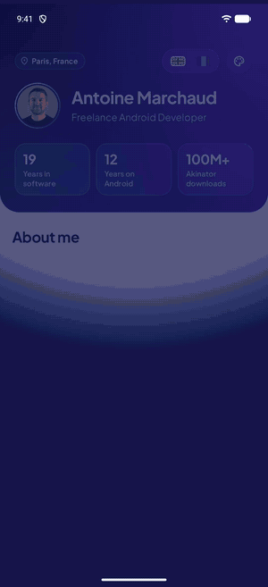
  <br/>
  <a href="screenshots/demo.mp4">Watch the demo in HD (MP4)</a>
</p>

## Screenshots

### Android

<p align="center">
  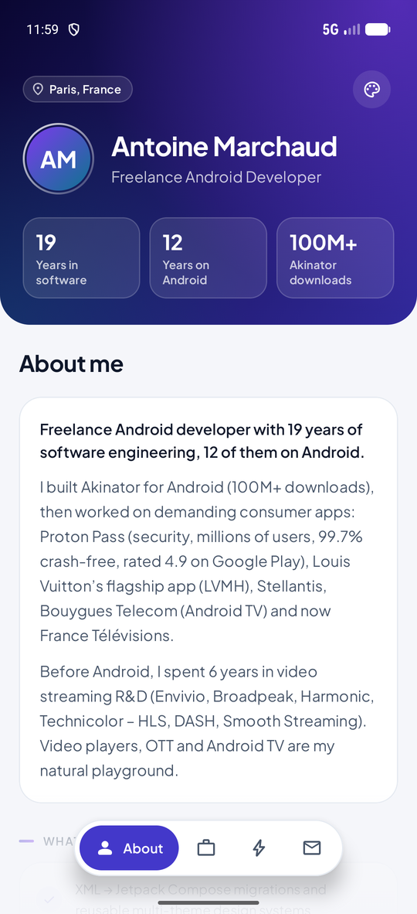
  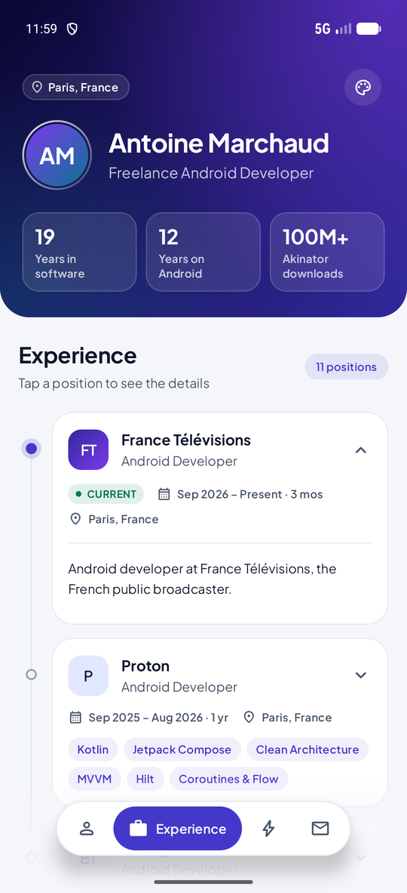
  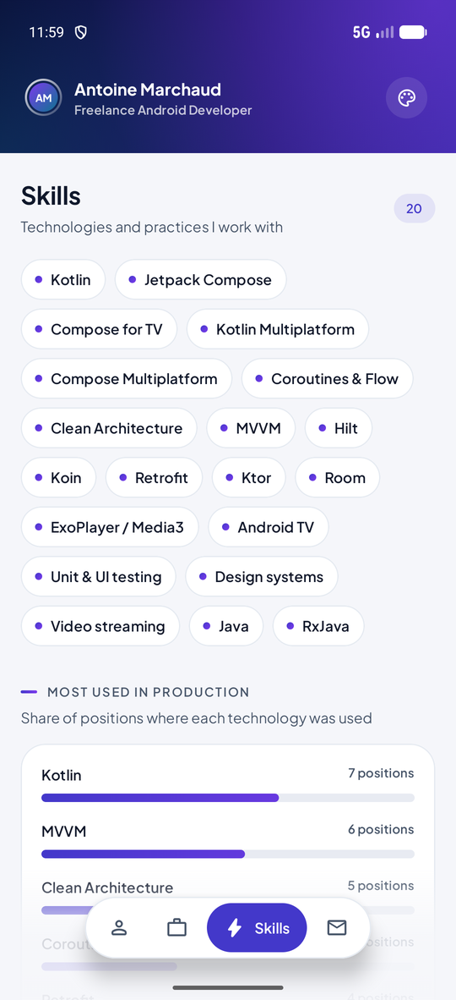
  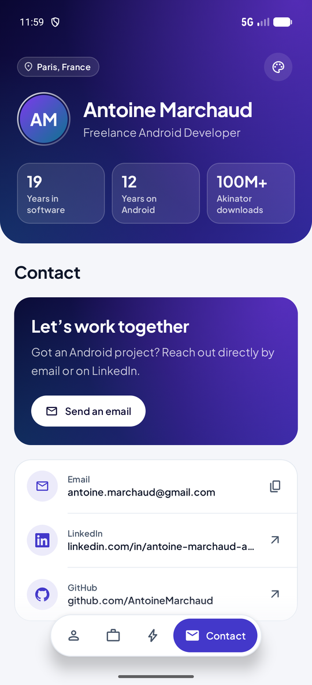
</p>
<p align="center">
  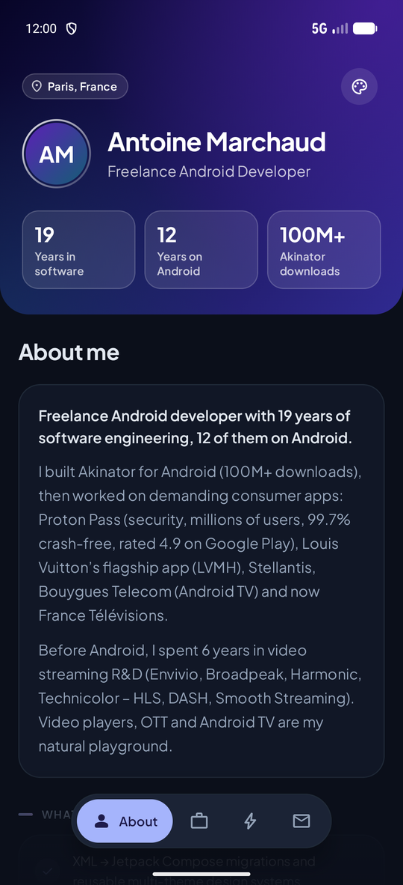
  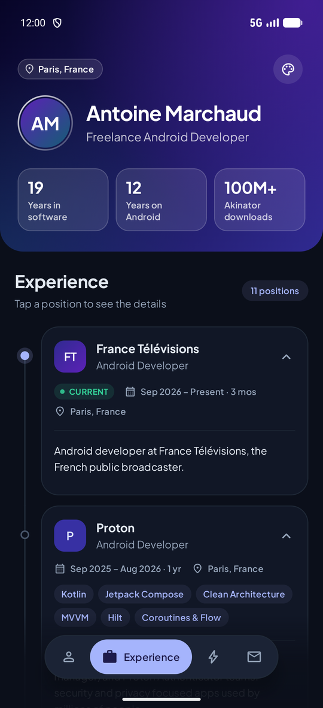
</p>

| Foldable, unfolded | Foldable, tabletop posture |
|:---:|:---:|
| 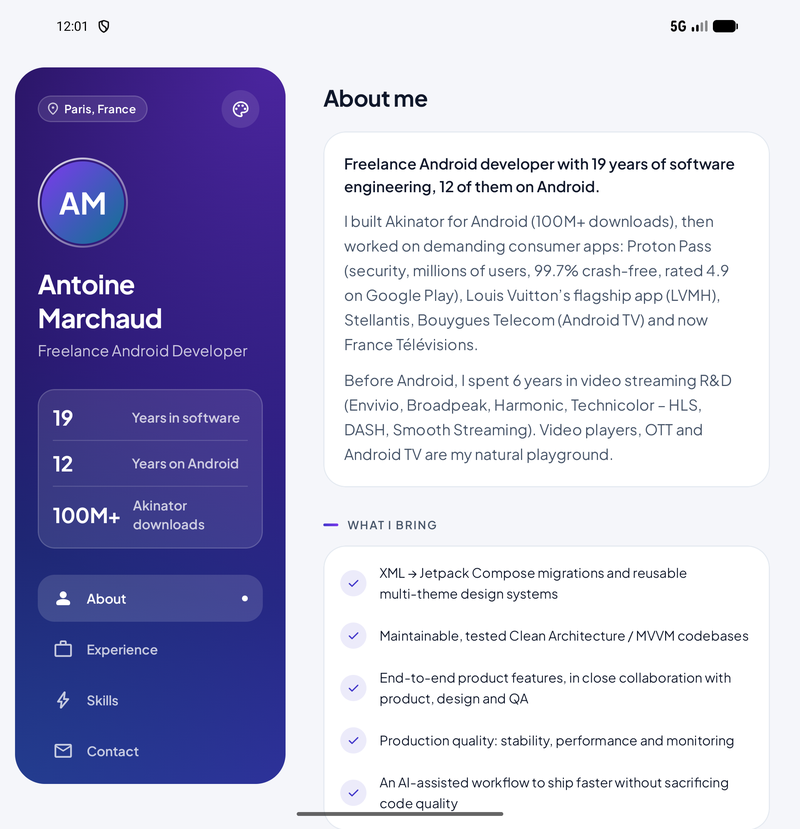 | 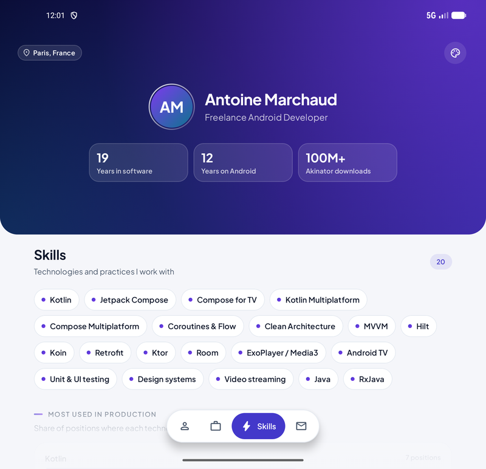 |

<p align="center">
  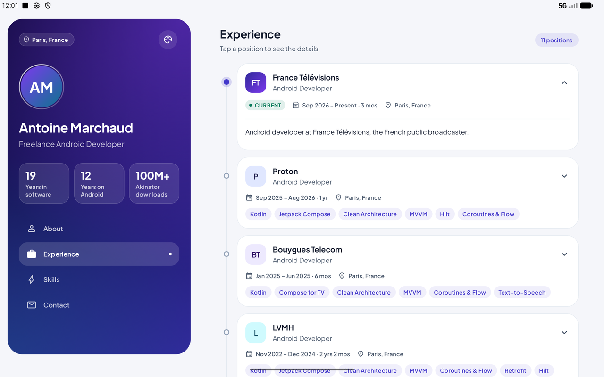
</p>

### iOS

<p align="center">
  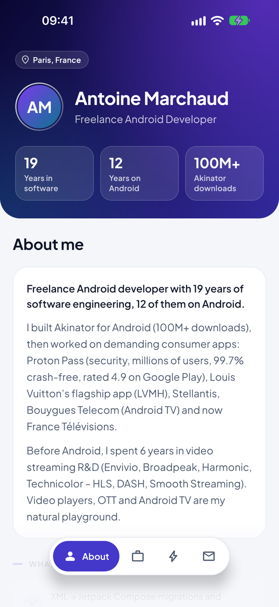
  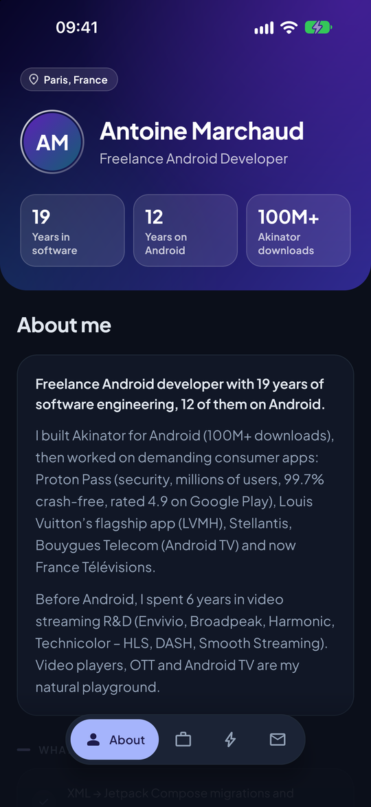
  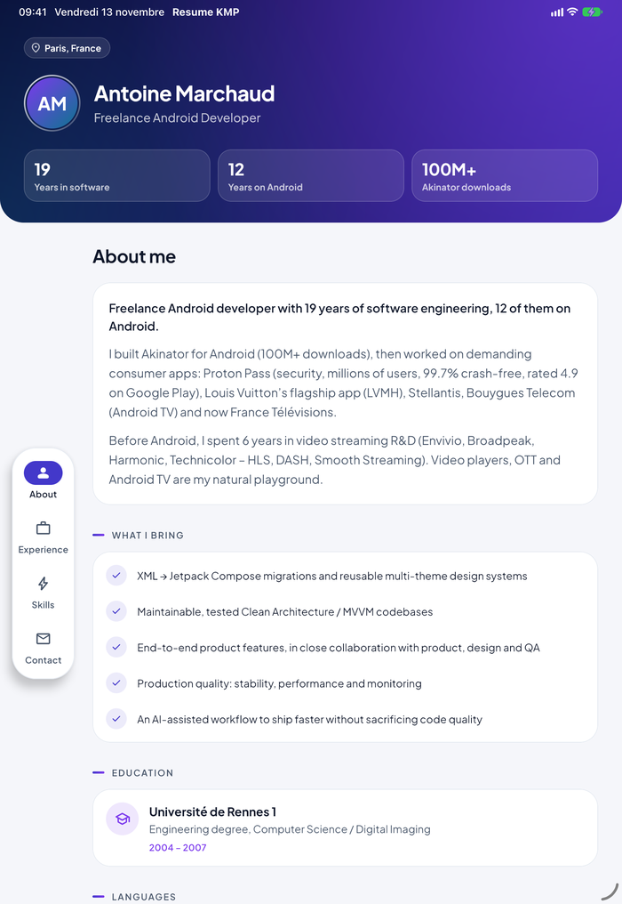
  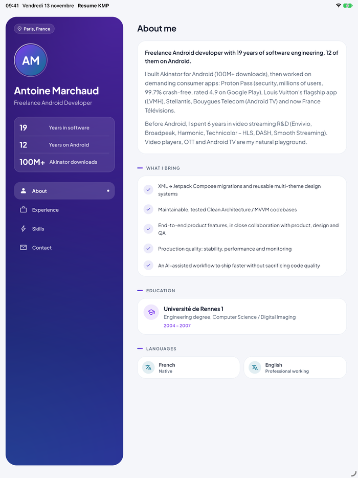
</p>

### Desktop (JVM)

<p align="center">
  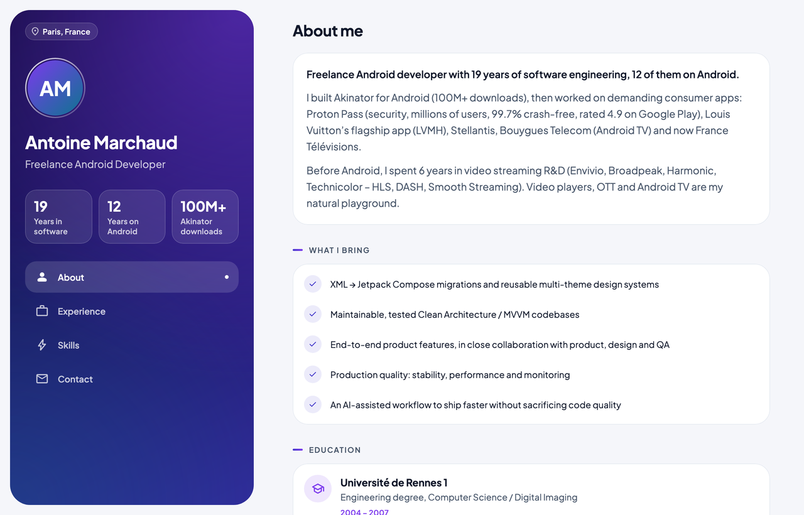
  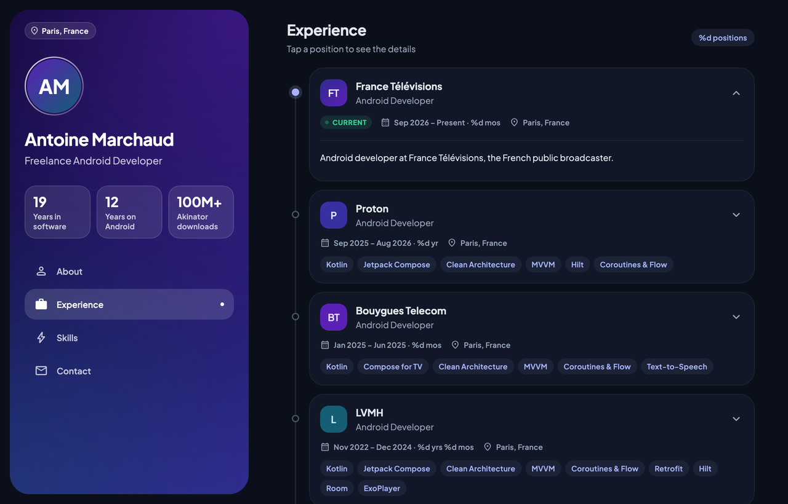
</p>

### Web (WebAssembly)

<p align="center">
  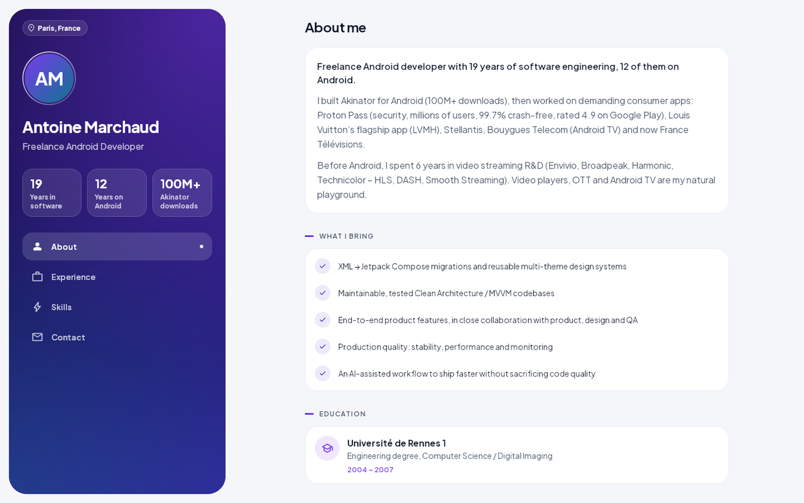
  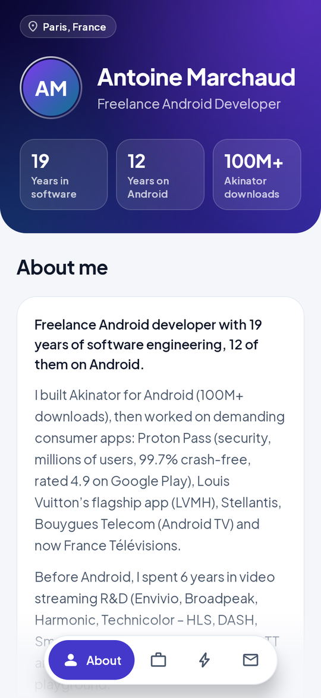
</p>
<p align="center">
  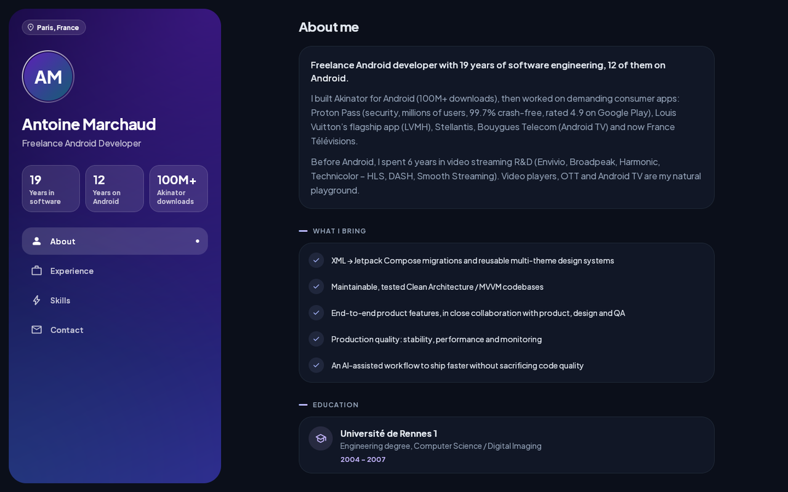
</p>

## Features

- **One UI for every platform**: the whole app (UI, resources, data, previews) lives in `shared/src/commonMain`.
- **Adaptive layouts** following the Material 3 window size classes and foldable postures:

  | Window | Layout |
  |---|---|
  | Phone, portrait | Collapsing hero header and floating navigation bar |
  | Medium width (iPad 11" portrait, small tablets, unfolded foldables) | Collapsing hero header and floating navigation rail |
  | Large screens, landscape phones, desktop, web | Two panes: profile and navigation on the left, content on the right |
  | Foldable in book posture | Two panes split exactly at the hinge |
  | Foldable in tabletop posture | Profile above the hinge, content and navigation below |

- **Four sections**: About (summary, strengths, education, languages), Experience (timeline), Skills (tags and usage chart), Contact.
- **Data-driven**: position durations, the "Current" badge, technology usage and company monograms are computed from the JSON.
- **Polished design system**: custom indigo palette for light and dark themes, Plus Jakarta Sans typography, hairline cards, gradient hero.
- **Native integration**: edge to edge with transparent system bars on Android, status bar style driven by the content on iOS, Material You colors on Android 12+.
- **Motion**: collapsing header, staggered entrance animations, expandable cards, animated charts, section transitions.
- **Compose previews** for every section and every adaptive mode (phone, tablet, foldable postures, light and dark), written in common code.

## Make it yours

Everything displayed comes from [`shared/src/commonMain/composeResources/files/resume_template.json`](shared/src/commonMain/composeResources/files/resume_template.json): edit it and run the app on any platform.

```jsonc
{
  "info": {
    "name": "Jane Doe",
    "job": "Senior Android Developer",
    "location": "Paris, France",                      // optional
    "stats": [{ "value": "10", "label": "Years on Android" }] // optional, computed when empty
  },
  "about": {                                           // optional
    "summary": ["First paragraph, displayed as a lead", "Next paragraphs"],
    "strengths": ["What you bring"]
  },
  "experiences": [
    {
      "company": "Acme",
      "role": "Android Developer",
      "start": "2024-03",                              // yyyy-MM
      "end": "2025-06",                                // omit for an ongoing position
      "location": "Paris, France",                     // optional
      "description": "One sentence about the position", // optional
      "highlights": ["What you did"],
      "technologies": ["Kotlin", "Jetpack Compose"],
      "appId": "com.acme.app"                          // optional, opens Google Play
    }
  ],
  "skills": ["Kotlin", "Jetpack Compose"],
  "education": [{ "school": "University", "degree": "Master's degree", "period": "2010 – 2015" }], // optional
  "languages": [{ "name": "English", "level": "Fluent" }], // optional
  "contact": {
    "email": "jane@example.com",
    "phone": "+33 6 00 00 00 00",                      // optional
    "githubUrl": "https://github.com/jane",            // optional
    "linkedInUrl": "https://www.linkedin.com/in/jane", // optional
    "message": "Short call to action"                  // optional
  }
}
```

Files written for the first version of the template (with a free-text `period` instead of `start` / `end`) are still supported.

## Run it

| Platform | Command |
|---|---|
| Android | `./gradlew :androidApp:installDebug` |
| iOS | Open `iosApp2/iosApp.xcodeproj` in Xcode and run the `iosApp` scheme |
| Desktop | `./gradlew :composeApp:run` |
| Web (WebAssembly) | `./gradlew :composeApp:wasmJsBrowserDevelopmentRun` |
| Web (JavaScript, older browsers) | `./gradlew :composeApp:jsBrowserDevelopmentRun` |

## Architecture

```
TemplateResumeKmp
├── shared                       Kotlin Multiplatform library: the whole app
│   └── src
│       ├── commonMain
│       │   ├── composeResources  Font, strings and plurals, resume JSON
│       │   └── kotlin/com/amarchaud/shared
│       │       ├── App.kt        Root composable shared by every platform
│       │       ├── data          JSON model, parsing, repository, pure insights (dates, durations…)
│       │       ├── di            Koin module
│       │       ├── platform      expect declarations (Material You, system bars, clipboard)
│       │       └── ui            ViewModel, theme, icons, components, adaptive screens, previews
│       ├── androidMain, iosMain, jvmMain, webMain…   actual implementations
│       ├── commonTest            Tests run on JVM, Android, iOS, JS and Wasm
│       └── jvmTest               Bundled JSON and Compose UI tests
├── composeApp                   Entry points: iOS framework, desktop app, web app (Wasm and JS)
├── androidApp                   Android application
└── iosApp2                      Xcode project: UIKit app hosting Compose, owning the status bar style
```

- **MVVM**: `ResumeViewModel` exposes a `StateFlow` of loading, success and error states, fed by `ResumeRepository`.
- **Koin** provides the repository and the ViewModel on every platform.
- **100% Kotlin and Compose Multiplatform**: no Java API in common code; platform APIs only appear in the few `actual` implementations.

## Tech stack

| | |
|---|---|
| UI | Compose Multiplatform 1.12.2, Material 3, `material3-adaptive` (window size classes and foldable postures), Compose resources |
| Architecture | `lifecycle-viewmodel-compose`, Koin 4.2.2 |
| Data | `kotlinx.serialization` (JSON), `kotlinx-datetime` (dates and durations) |
| Tests | `kotlin.test`, `kotlinx-io`, Compose UI tests (`runComposeUiTest`) |
| Build | Gradle 9.9.1 with version catalog and configuration cache, AGP 9.5.1, Kotlin 2.4.21, Java 21 toolchain |

## Build and checks

```bash
./gradlew build    # every target, tests on JVM, Android, iOS simulator, JS and Wasm (headless Chrome), lint
```

No warning comes from the project code or build scripts. With Kotlin 2.4.21, the Kotlin Gradle Plugin still reports
a few warnings about Compose Multiplatform's dependency graph (duplicated klibs and a native attribute type), fixed in Kotlin 2.5.0.

## Credits

- Font: [Plus Jakarta Sans](https://fonts.google.com/specimen/Plus+Jakarta+Sans), SIL Open Font License 1.1
- Icons: [Material Symbols](https://fonts.google.com/icons), Apache License 2.0
- Brand icons: [Simple Icons](https://simpleicons.org), CC0 1.0
